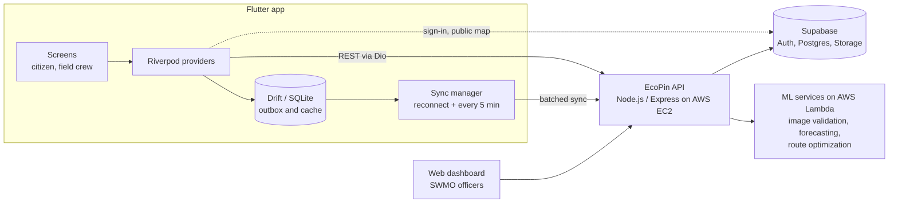
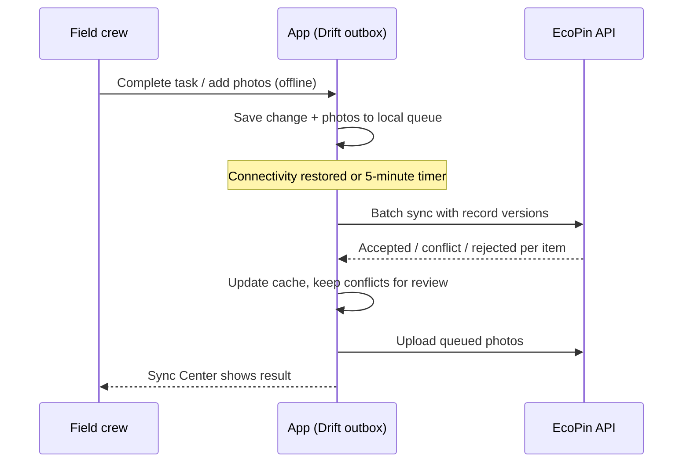

# EcoPin Mobile App

**A Flutter app that lets Pasig City residents report environmental problems with GPS-stamped photo evidence, and gives cleanup crews an offline-first workspace for their assigned routes.**


EcoPin is our BSIT capstone project at Pamantasan ng Lungsod ng Pasig, built for the Pasig City Solid Waste Management Office (SWMO). This repository is the mobile client used by **citizens** and **field crews**. SWMO officers and administrators use the [web dashboard](https://github.com/baldopadua/ecopin-web).

**Download the Android build:** [ecopin-web.vercel.app/downloads](https://ecopin-web.vercel.app/downloads) · **Web dashboard:** [ecopin-web.vercel.app](https://ecopin-web.vercel.app)

<!-- Screenshot placeholder: add phone screenshots (citizen report flow, public map, crew route) at docs/images/, then uncomment:
<p align="center">
  
  
  
</p>
-->

## The EcoPin repositories

| Repository | What it is |
| --- | --- |
| [ecopin_backend_node](https://github.com/klacom/ecopin_backend_node) | Node.js/Express REST API, background jobs, SQL migrations |
| **[ecopin_app](https://github.com/klacom/ecopin_app)** (you are here) | Flutter mobile app for citizens and field crews |
| [ecopin_ml_models](https://github.com/klacom/ecopin_ml_models) | Python services: image validation, hotspot forecasting, route optimization |
| [ecopin-web](https://github.com/baldopadua/ecopin-web) | Next.js web dashboard for SWMO officers and administrators |

## Features

### For citizens

- **Report an issue with verified evidence.** Photos taken in the app get a TimeMark-style stamp burned into the image: GPS coordinates, accuracy, timestamp, and the Pasig address. The app also checks for mock-location (fake GPS) apps.
- **Pin the exact spot.** Place the report on a map, with place search and voice search.
- **Instant photo check.** Photos are sent to the AI image validator before you submit, so obviously invalid images are caught early.
- **Set priority and privacy.** Mark a report Urgent or Non-urgent, report anonymously, and attach a short in-app video clip.
- **Report offline.** Reports are saved to a local SQLite queue and submitted when the phone is back online.
- **Follow up.** See each report's status and response deadline, view before/after cleanup photos, close the report or flag the cleanup as incomplete, and rate the service.
- **Public map.** Browse reports with marker clustering and a heatmap layer.
- **Account and help.** Notifications, support tickets, official contacts, trust status, password change, account deletion, and light/dark themes.

### For field crews

- **Shift dashboard:** current objective, shift progress, task queue, and deadlines.
- **Route map:** ordered stops, the route line, and spoken turn prompts (text-to-speech).
- **On-site work:** up to 5 before and 5 after photos per report, cleanup notes, "cannot work" reports, urgency observations, and investigation check-ins.
- **Offline packages:** download assigned tasks, routes, report details, and addresses before heading into areas with poor signal.
- **Sync Center:** every offline change goes into a local outbox. It syncs automatically on reconnect and every 5 minutes, and shows failures, retries, and server conflicts. Work that was mid-upload when the app closed is recovered on the next launch.

Officer and administrator accounts are routed to a sign-out screen in the app; their workspace is the web dashboard.

## Tech stack

| Area | Tools |
| --- | --- |
| Framework | Flutter (Dart 3), Material 3, custom Outfit typography |
| State and navigation | Riverpod 3, go_router |
| Networking and auth | Dio (REST client for the EcoPin API), supabase_flutter (auth, deep-link sign-in), app_links |
| Offline storage | Drift on SQLite (outbox, cached tasks, routes, photos), shared_preferences |
| Maps and location | flutter_map with CARTO tiles, marker clustering, [heatmap layer (fork)](https://github.com/klacom/fluttermap_heatmap), geolocator, flutter_polyline_points |
| Media | image_picker, `image` (photo stamping), video_player, cached_network_image |
| Device | connectivity_plus, flutter_local_notifications, speech_to_text, flutter_tts, share_plus |
| Testing | flutter_test (sync, offline, reports, and UI tests) |

## Architecture



The app writes through the [EcoPin API](https://github.com/klacom/ecopin_backend_node), which validates every change and calls the [ML services](https://github.com/klacom/ecopin_ml_models). Supabase is used directly only for sign-in and public map reads.

### How offline sync works



## My role

EcoPin was built by a two-person team. I wrote most of this app (about 100 of the 143 commits on this branch). My work here:

- **Field-crew workspace:** built most of `features/field_crew`: dashboard, task and route screens, voice navigation, and before/after photo capture.
- **Offline-first sync:** designed the Drift database, the outbox and photo sync managers, offline packages, the Sync Center, and crash recovery for in-flight uploads.
- **Report flow:** built the GPS-stamped photo verification, the instant AI photo check, and the offline report queue.
- **Testing:** wrote nearly all of the widget, sync, and offline tests.

My teammate **Charles Jeramy De Padua** contributed to the report screens, maps, authentication, and shared services.

## Getting started

### Prerequisites

- [Flutter SDK](https://docs.flutter.dev/get-started/install) with Dart 3.12 or newer
- Android Studio or an Android device/emulator (Android is the released target)
- A running [EcoPin backend](https://github.com/klacom/ecopin_backend_node#getting-started) and a Supabase project
- A [CARTO](https://carto.com/basemaps) key for map tiles

### Install and run

```bash
git clone https://github.com/klacom/ecopin_app.git
cd ecopin_app
cp .env.example .env      # fill in your own values
flutter pub get
flutter run
```

Run the tests:

```bash
flutter test
```

Build a release APK:

```bash
flutter build apk --release
```

### Environment variables

The app loads `.env` at start-up with `flutter_dotenv`. Use public values only. See [`.env.example`](.env.example).

| Key | Purpose |
| --- | --- |
| `BACKEND_URL` | Base URL of the EcoPin API |
| `WEB_BASE_URL` | Public web URL for shared report links and the photo stamp |
| `NEXT_PUBLIC_SUPABASE_URL` | Supabase project URL |
| `SUPABASE_PUBLISHABLE_KEY` | Supabase publishable (anon) key |
| `CARTO_API_KEY` | Basemap tiles |
| `SYNTHETIC_TEST` | Test-only: skip live GPS capture |

## Project structure

```text
lib/
├── main.dart                 # env, Supabase, deep links, sync recovery
├── app.dart
├── routes/                   # go_router config and role-based redirects
├── core/
│   ├── database/             # Drift schema (outbox, caches)
│   ├── services/             # API client, sync, camera, location, photo verification
│   ├── theme/                # colors, typography
│   └── utils/
├── features/
│   ├── citizen/              # citizen shell and navigation
│   └── field_crew/           # dashboard, routes, offline packages, sync engine
└── shared/
    ├── auth/                 # login, registration, email verification
    ├── reports/              # create report, details, cleanup proof, rating
    ├── maps/                 # public map, location search, voice search
    ├── notifications/
    ├── profile/
    └── support/              # support tickets, official contacts
test/                         # sync, offline, reports, and UI tests
packages/flutter_rotation_sensor/   # vendored plugin override
```

UI conventions, role boundaries, and design tokens are documented in [DESIGN.md](DESIGN.md).

## Team and credits

- **Klarenz Cobie O. Manrique** ([@klacom](https://github.com/klacom)): mobile app, backend, ML services, DevOps
- **Charles Jeramy C. De Padua** ([@baldopadua](https://github.com/baldopadua)): web dashboard, mobile app, backend
- **Adviser:** Greta M. Rosario, DIT

Capstone project, *EcoPin A.I.: Crowdsourced Geospatial Platform for Transparent Environmental Reporting and Rapid Institutional Detection for the Pasig City Solid Waste Management Office*. BS Information Technology, College of Computer Studies, Pamantasan ng Lungsod ng Pasig.

## Related repositories

- [klacom/ecopin_backend_node](https://github.com/klacom/ecopin_backend_node): REST API and background jobs
- [klacom/ecopin_ml_models](https://github.com/klacom/ecopin_ml_models): image validation, forecasting, and routing services
- [baldopadua/ecopin-web](https://github.com/baldopadua/ecopin-web): web dashboard ([live](https://ecopin-web.vercel.app))
